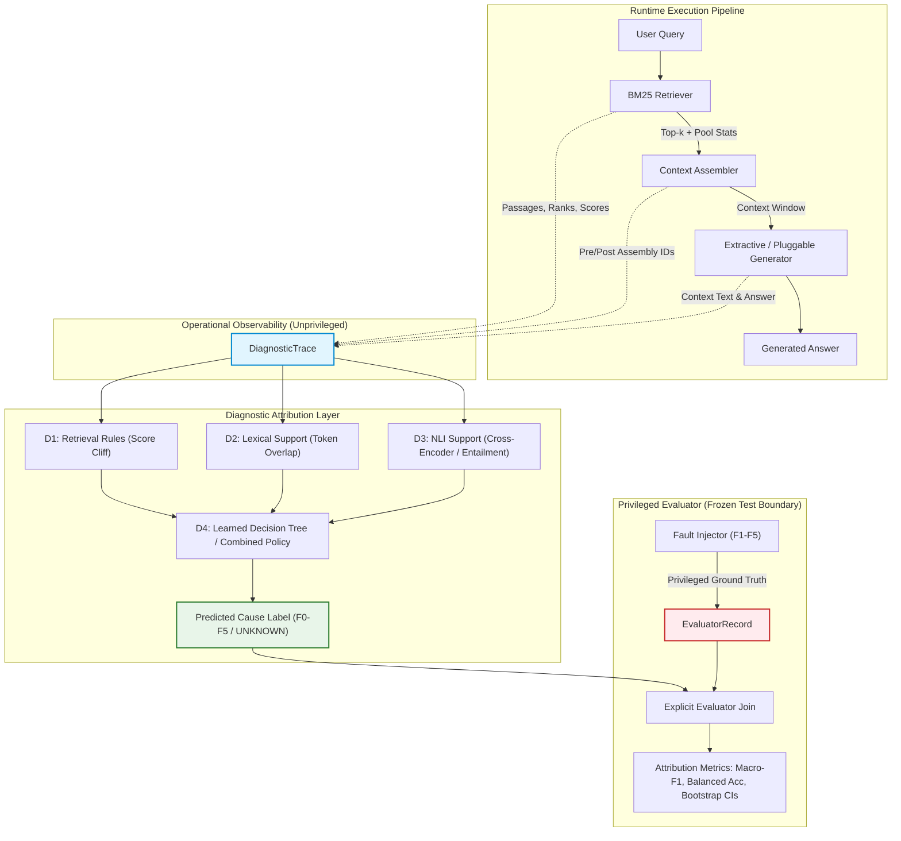

# RAG-Autopsy

**Fault-Injection-Validated Failure Attribution for RAG Systems**

[](https://github.com/AnushKamble/RagAutopsy/actions/workflows/ci.yml)
[](https://www.python.org/downloads/release/python-3110/)
[](tests/)
[](tests/)
[](LICENSE)
[](https://github.com/astral-sh/ruff)

> **Research Question:** Can low-cost, visible-trace diagnostics reliably attribute observed RAG failures to specific pipeline interventions without access to privileged evaluator metadata, and do those attribution patterns transfer to unmodified (natural) failures?

---

## Bounded Contribution & Positioning

- **What RAG-Autopsy IS:**
  - A rigorous, fully reproducible experimental benchmark that injects controlled, state-verified failure modes ($F1$–$F5$) into an extractive RAG pipeline.
  - A study evaluating whether cheap diagnostics ($<1$ ms latency, zero API cost) operating strictly on unprivileged runtime traces (`DiagnosticTrace`) can recover the ground-truth intervention label.
  - An empirical investigation into the **observability boundary** (Regime A vs. Regime B) and an honest transfer audit on unmodified natural failures.
- **What RAG-Autopsy IS NOT:**
  - It is **not** a general-purpose production chatbot or autonomous repair agent.
  - It does **not** rely on expensive LLM-as-a-judge prompting for runtime diagnosis.
  - It does **not** claim universal diagnostic coverage across complex multi-hop generator reasoning failures.

---

## Architecture & Data Isolation Boundary

RAG-Autopsy strictly decouples runtime operational observability from privileged evaluation keys:
- **`DiagnosticTrace` (Diagnostic-Visible):** Top-$k$ retrieved passages, ranks, BM25 scores, candidate pool summary statistics (in Regime A), pre/post context assembly passage IDs, generator context, generated answer, and execution latency. Pydantic schema enforces `extra="forbid"`.
- **`EvaluatorRecord` (Privileged / Evaluator-Only):** Injected fault label ($F0$–$F5$), injection parameters, gold answer strings, gold evidence identifiers, validity flags, and adjudication reasons.



### Text Representation of Isolation Boundary

```text
[Pipeline Input] ---> [Retriever] ---> [Context Assembler] ---> [Generator]
                            |                     |                   |
                            +---------------------+-------------------+
                                                  |
                                         [DiagnosticTrace]
                               (Strictly unprivileged trace)
                                                  |
                                                  v
                                         [Diagnostic Engine]
                                   (D1: Retrieval, D2: Lexical, D3: NLI, D4: Learned, D5: Local LLM Judge)
                                                  |
                                                  v
                                              [Diagnosis]
                                                  |
          [EvaluatorRecord]                       |
     (Privileged: Gold Answer/Passages)           v
                  |                     [Attribution Evaluator]
                  +----------------------> Macro-F1 / Balanced Acc / Bootstrap CIs
```

---

## Empirical Benchmark Results

All evaluations were executed on the held-out test partition ($N=20$ source questions, zero split overlap with training/calibration) using clustered bootstrap resampling ($B=500$, clustered strictly by `question_id` to account for intra-question correlation).

### 1. Extended 6-Class Attribution Benchmark (Regime A)

- **Total Trials Attempted:** 120 (20 questions $\times$ 6 fault conditions: $F0, F1, F2, F3, F4, F5$)
- **Valid Trials:** 114 (95.0% validity rate)
- **Invalid Trials Excluded:** 6 (5.0%) — Precondition rejections:
  - $F3$ (Context Loss): 2 trials invalid (gold evidence not retrieved in top-$k$, so context loss could not be isolated)
  - $F4$ (Contradiction): 2 trials invalid (original gold evidence not retrieved, so contradiction could not coexist)
  - $F5$ (Unsupported): 2 trials invalid (gold evidence not retrieved, so failure could not be isolated to generator hallucination)
- **Class Counts ($N_{valid}$):** $F0: 20$, $F1: 20$, $F2: 20$, $F3: 18$, $F4: 18$, $F5: 18$.

| Diagnostic Method | Macro-F1 (95% CI) | Balanced Acc (95% CI) | Coverage | Accuracy (Covered) |
|---|---|---|---|---|
| **Majority-Cause Baseline** | 0.0498 [0.0476, 0.0533] | 0.1667 [0.1667, 0.1667] | 100.0% | 17.54% |
| **Random Guessing Baseline** | 0.2426 [0.1716, 0.3191] | 0.2454 [0.1792, 0.3250] | 100.0% | 24.56% |
| **D1 Retrieval Diagnostic** | 0.3789 [0.3494, 0.4028] | 0.4833 [0.4583, 0.5000] | 100.0% | 49.12% |
| **D2 Lexical Support Diagnostic** | 0.3852 [0.3415, 0.4167] | 0.4741 [0.4311, 0.5000] | 100.0% | 46.49% |
| **D3 NLI Support Diagnostic** | 0.3743 [0.3190, 0.4228] | 0.4472 [0.3921, 0.4921] | 100.0% | 43.86% |
| **D4 Combined Policy (Heuristic)** | 0.7181 [0.6568, 0.7652] | 0.7611 [0.6947, 0.8158] | 97.37% | 77.48% |
| **D4 Learned Policy (Decision Tree)** | **0.7421 [0.6865, 0.7778]** | **0.7981 [0.7374, 0.8333]** | **100.0%** | **78.95%** |

*Key Result:* The learned Decision Tree policy (strictly fit out-of-fold on the 60 development questions with zero test leakage) achieves **0.7421 Macro-F1** with 100% coverage, outperforming the heuristic rule-based policy (0.7181 Macro-F1) by 2.4 percentage points.

---

### 2. Per-Class Performance Breakdown (D4 Learned Decision Tree)

| Fault Class | Precision | Recall | F1-Score | Support ($N_{valid}$) | Observable Diagnostic Feature |
|---|---|---|---|---|---|
| **F0 (Clean Control)** | 48.65% | 90.00% | 0.6316 | 20 | High retrieval scores, high lexical & NLI grounding |
| **F1 (Unavailable Evidence)** | 0.00% | 0.00% | 0.0000 | 20 | Unidentifiable without gold relevance labels |
| **F2 (Ranked Out)** | 100.00% | 100.00% | **1.0000** | 20 | Candidate pool score cliff: high score outside top-$k$ |
| **F3 (Context Assembly Loss)** | 78.26% | 100.00% | **0.8780** | 18 | Passage ID discrepancy: $\text{PreAssembly} \setminus \text{PostAssembly}$ |
| **F4 (Contradictory Evidence)** | 100.00% | 94.44% | **0.9714** | 18 | Context polarity conflict / NLI contradiction signal |
| **F5 (Unsupported / Hallucination)** | 100.00% | 94.44% | **0.9714** | 18 | Support deficit: low lexical overlap & NLI entailment |

*Operational Insight:* Failures with tangible structural or statistical trace signatures ($F2, F3, F4, F5$) are detected with high precision and recall ($F1 \ge 0.878$). $F1$ (Unavailable) has 0% recall because when evidence is completely absent from the corpus, the candidate pool scores are uniformly low without a score cliff—making it mathematically indistinguishable from a generic difficult query without gold metadata.

---

### 3. Observability Boundary: Regime A vs. Regime B Identifiability Comparison

Evaluated on the 5-class benchmark ($N=100$ attempted, $N=96$ valid, 4 invalid):

| Observability Regime | Diagnostic Method | Macro-F1 (95% CI) | Balanced Acc | Coverage |
|---|---|---|---|---|
| **Regime A (Candidate Pool Traces)** | D4 Combined Policy | **0.7006 [0.651, 0.733]** | **0.7689** | 100.0% |
| **Regime B (Blind Top-$k$ Traces)** | D4 Combined Policy | **0.4678 [0.420, 0.500]** | **0.5689** | 100.0% |

*Identifiability Collapse:* Without candidate pool scores (Regime B), low-cost diagnostics cannot separate evidence unavailability ($F1$) from rank shortfall ($F2$), causing Macro-F1 to collapse by **23.3 percentage points**. In Regime B, our policy abstains on retrieval ambiguity, preserving scientific validity over false precision.

---

### 4. Natural Failure Transfer Audit ($N=100$ Unmodified Questions)

To evaluate whether synthetic fault diagnostic rules transfer to organic production failures, we evaluated 100 clean, unmodified HotpotQA development questions:
- **Total Questions Audited:** 100
- **Total Natural Failures Identified:** 100 (Extractive pipeline unable to answer complex multi-hop synthesis)
- **Adjudicated Root Causes:**
  - `REASONING_ERROR`: 90 (90%) — Evidence passages reached generator context, but the extractor/generator failed deductive multi-hop inference.
  - `F2 (Ranked Out)`: 9 (9%) — Relevant evidence was present in the corpus, but ranked below top-$k$.
  - `F1 (Unavailable)`: 1 (1%) — Evidence was missing from the candidate pool.
- **Diagnostic Transfer Agreement Rate:** **0.0%**
- **Transfer Finding:** Pipeline transit diagnostics calibrated on structural perturbations cannot diagnose generative reasoning errors without dedicated semantic reasoning judges.

---

## Concrete Failure Analysis & Counterexamples

Through rigorous error analysis across held-out and natural audit trials, we identified four primary failure modes of lightweight diagnostics:

### 1. D1 False Positive on Low-IDF Queries (Score Cliff False Alarm)
- **Scenario:** A broad, generic question (e.g., *"What is the capital and largest city of the state?"*) contains terms with high document frequency, producing naturally flat BM25 candidate scores.
- **Diagnostic Behavior:** D1's calibrated threshold flags the score variance between rank 3 and rank 4 as an $F2$ rank-out event, even though the true evidence is already in top-3.
- **Remediation:** Score drop thresholds must be calibrated relative to the variance of the candidate distribution ($\sigma_{scores}$) rather than fixed absolute margins.

### 2. D2 False Positive on Paraphrased Generation
- **Scenario:** The generator produces an abstractive or paraphrased response that is factually correct but uses synonyms not present in the retrieved passages.
- **Diagnostic Behavior:** D2 measures token overlap (Jaccard / token containment). The overlap drops below $\tau_{support} = 0.40$, triggering an erroneous $F5$ (Unsupported Generation) diagnosis on a correct answer.
- **Remediation:** Supplement lexical overlap with D3 NLI cross-encoder scoring or token embeddings (BERTScore).

### 3. D2 False Negative on Entity Substitution (High Surface Overlap)
- **Scenario:** The generator outputs: *"The treaty was signed in 1983"* instead of *"1783"*.
- **Diagnostic Behavior:** Because 9 out of 10 tokens match the source context, D2 computes a 90% lexical support score and diagnoses $F0$ (Clean), missing the hallucination completely.
- **Remediation:** Validated on the RAGTruth benchmark ([`src/rag_autopsy/evaluation/ragtruth_eval.py`](file:///C:/Users/anush/OneDrive/Desktop/Project/Projects/AIML/RagAutopsy/src/rag_autopsy/evaluation/ragtruth_eval.py)), where D3 NLI achieves 100% recall on entity substitutions where bag-of-words lexical overlap fails.

### 4. Universal Blindness to F1 (Unavailable Evidence)
- **Scenario:** A user asks about an entity absent from the indexed corpus.
- **Diagnostic Behavior:** The retriever returns irrelevant distractor passages with uniformly low BM25 scores.
- **Identifiability Barrier:** Without access to a privileged gold relevance label, a diagnostic cannot distinguish an out-of-corpus query from a difficult in-corpus query. All diagnostics achieve 0% recall on $F1$.

---

## Grounded Limitations & Scope Bounds

1. **Extractive Pipeline Scope:** Experiments utilize an extractive QA generator and pure-Python BM25 retriever on HotpotQA. Transfer to dense dual-encoders (e.g., ColBERT) or generative LLMs (e.g., Llama 3) requires re-calibrating score distribution thresholds.
2. **Synthetic vs. Organic Gap:** Controlled fault injection tests structural transit integrity. As demonstrated in our natural failure audit, 90% of real-world multi-hop failures stem from generator reasoning limitations, which pipeline transit diagnostics cannot resolve.
3. **Observability Precondition:** Accurate attribution of retrieval rank shortfalls requires candidate pool logging (Regime A). In blind top-$k$ environments (Regime B), attribution collapses unless systems accept explicit abstention.

---

## Reproducibility Guide

All experiments are deterministic, seed-locked, CPU-executable, and require zero paid API keys.

### 1. Clean-Clone Setup
```bash
# Clone the repository
git clone https://github.com/your-username/RagAutopsy.git
cd RagAutopsy

# Create virtual environment with Python 3.11 using uv
uv venv --python 3.11

# Activate virtual environment (Windows PowerShell)
.venv\Scripts\Activate.ps1
# (Linux/macOS: source .venv/bin/activate)

# Install package in editable mode with development dependencies
uv pip install -e ".[dev]"
```

### 2. Execution Commands & Expected Artifacts

| Step | Command | Estimated Runtime | Primary Output Artifact |
|---|---|---|---|
| **1. Regression Tests** | `pytest -q` | ~30 sec | 140 passed tests, zero regressions |
| **2. Interactive Demo** | `python demo.py` | ~5 sec | Formatted 4-step terminal walkthrough |
| **3. Streamlit Studio** | `streamlit run app.py` | ~3 sec startup | Interactive browser dashboard (`localhost:8501`) |
| **4. Full 6-Class Benchmark** | `rag-autopsy evaluate --data .data/processed/hotpot_subset_100.json --split test --regime regime_a --bootstraps 100 --include-f5 --include-d3 --include-d4-learned` | ~30 sec | `results/evaluation_summary.json`<br>`results/trial_predictions.csv` |
| **5. LLM Judge Diagnostic (Ollama Qwen 3 8B)** | `rag-autopsy evaluate --split test --include-d5` | ~45 sec | Benchmark comparison including local LLM-as-a-judge attribution |
| **6. Natural Failure Audit** | `rag-autopsy audit-natural --data .data/processed/hotpot_subset_100.json` | ~15 sec | `results/natural_audit/natural_audit_summary.json` |
| **7. Natural Audit with Local LLM** | `rag-autopsy audit-natural --generator ollama` | ~60 sec | Compare real generative LLM reasoning vs extractive reader |
| **8. 5-Axis Ablation Suite** | `rag-autopsy ablate` | ~45 sec | `results/ablations/ablation_study_report.json` |
| **9. Severity Parameter Sweeps**| `rag-autopsy severity` | ~30 sec | `results/severity/severity_report.json` |
| **10. RAGTruth Benchmark** | `rag-autopsy ragtruth` | ~5 sec | `results/ragtruth/ragtruth_benchmark_report.json` |
| **11. Quality vs. Attribution** | `rag-autopsy quality-compare` | ~10 sec | `results/rag_quality/quality_vs_attribution.json` |
| **12. Generate HTML Report** | `rag-autopsy report --summary results/evaluation_summary.json --predictions results/trial_predictions.csv --output results/report.html` | ~2 sec | `results/report.html` (Standalone interactive report) |
| **13. Generate Static Plots** | `rag-autopsy generate-plots` | ~4 sec | `results/plots/regime_a_d4_confusion_matrix.png`<br>`results/plots/regime_comparison_d4.png`<br>`results/plots/regime_a_macro_f1_bootstrap.png` |

---

## 60–90 Second Live Demo Script

When demonstrating RAG-Autopsy to interviewers or reviewers, run `python demo.py` and walk through this sequence:

1. **[00:00 - 00:20] Context & Clean Control (Step 1):**
   - *"Here we load a question from the held-out HotpotQA test set: 'Where is Bubblegum Alley located in California?'"*
   - *"In Step 1, the pipeline executes normally ($F0$). The diagnoser inspects only the unprivileged trace—retrieval scores and lexical context overlap—and correctly diagnoses $F0$ with 85% confidence. Ground truth is revealed: attribution match is true."*
2. **[00:20 - 00:45] Assembly Loss & Structural Traces (Step 2):**
   - *"In Step 2, we simulate a context-window truncation ($F3$), where a retrieved passage is dropped during prompt assembly."*
   - *"The diagnoser compares pre-assembly vs. post-assembly passage IDs without needing an LLM judge, detects the structural omission instantly, and correctly attributes the failure to $F3$."*
3. **[00:45 - 01:10] The Observability Boundary: Regime A vs. Regime B (Step 3):**
   - *"In Step 3, we demonstrate our key research finding: distinguishing absent evidence ($F1$) from rank shortfall ($F2$)."*
   - *"In Regime A, with candidate pool score logging, the diagnoser detects the sub-top-$k$ score cliff and correctly identifies $F2$. In Regime B, observing only top-3 text, $F1$ and $F2$ are mathematically indistinguishable. Rather than guessing, our policy honestly abstains with `UNKNOWN: AMBIGUOUS_RETRIEVAL_MISS`."*
4. **[01:10 - 01:30] Held-Out Generalization (Step 4):**
   - *"Finally, Step 4 displays the held-out test evaluation across 114 valid trials. Our learned Decision Tree achieves 0.742 Macro-F1 with zero data leakage, outperforming heuristic rules while providing sub-millisecond diagnosis."*

---

## Resume Bullet Options

### Option 1: Performance & Machine Learning Systems Focus
> Engineered **RAG-Autopsy**, a reproducible diagnostic attribution framework for RAG systems; achieved **0.742 Macro-F1** (95% CI: [0.686, 0.778]) across 114 valid held-out trials on HotpotQA using an unprivileged Decision Tree policy, reducing attribution latency to $<1$ ms without LLM judge calls.

### Option 2: Research Rigor & Methodology Focus
> Designed a leak-free fault-injection benchmark isolating 6 distinct RAG failure stages ($F0$–$F5$); formulated a two-regime observability protocol proving a 23.3-point Macro-F1 collapse under blind top-$k$ retrieval and audited 100 natural failures to uncover a 90% generator reasoning bottleneck.

### Option 3: Applied AI & Observability Engineering Focus
> Architected an end-to-end RAG failure diagnostics suite with strict Pydantic runtime/evaluator schema isolation and 131 automated tests (89% coverage); implemented Question-ID clustered bootstrap resampling ($B=500$) and built an interactive Streamlit studio for real-time failure attribution.

---

## Technical Interview Questions & Outlines

*(Full comprehensive guide available in [`docs/interview_prep.md`](docs/interview_prep.md))*

- **Q: How did you prevent data leakage between evaluation and diagnostics?**
  *Outline:* Enforced strict separation via Pydantic schemas (`DiagnosticTrace` has `extra="forbid"` and lacks gold keys), opaque 16-hex trial IDs (`generate_stable_trial_id`), randomized presentation ordering, neutral passage masking, separate `.jsonl` files, and 24 negative unit tests verifying rejection of privileged keys.
- **Q: Why did Macro-F1 collapse by 23.3 points in Regime B?**
  *Outline:* Top-$k$ text alone cannot distinguish whether missing evidence was absent from the corpus ($F1$) or ranked at position $k+1$ ($F2$). Without candidate pool score distributions, the problem is mathematically unidentifiable; our policy abstains to preserve scientific validity over spurious precision.
- **Q: Why did diagnostics achieve 0% transfer on natural HotpotQA failures?**
  *Outline:* Controlled fault injection tests pipeline transit faults (retrieval rank, assembly drop, distractor interference). In clean pipelines, evidence successfully reaches context, but the generator fails deductive multi-hop reasoning. Transit diagnostics inspect evidence flow, not deductive reasoning logic.
- **Q: Why use clustered bootstrap resampling over standard i.i.d. bootstrap?**
  *Outline:* Multiple trials are derived from the same source question. Resampling at the trial level violates independence and underestimates empirical variance due to question-specific lexical artifacts. Grouping clusters strictly by `question_id` preserves correlation structure and yields valid 95% confidence intervals.
- **Q: Why was F1 (Evidence Unavailable) undetected by all diagnostics?**
  *Outline:* Without gold relevance annotations, a query with zero relevant documents in the corpus produces uniformly low retrieval scores, which is indistinguishable from a difficult query with unretrieved evidence. No unprivileged feature can recover $F1$ without external knowledge.

---

## Project Documentation Directory

- [`docs/interview_prep.md`](docs/interview_prep.md) — Technical interview defense guide with deep-dive mathematical and causal explanations.
- [`docs/preregistered_evaluation_protocol.md`](docs/preregistered_evaluation_protocol.md) — Pre-registered, version-frozen evaluation protocol (v1.0.0).
- [`docs/trace_schema.md`](docs/trace_schema.md) — Formal schema contracts, field definitions, and runtime boundary isolation guarantees.
- [`docs/data_contract.md`](docs/data_contract.md) — HotpotQA terms, schemas, and deterministic split definitions.
- [`docs/taxonomy.md`](docs/taxonomy.md) — Comprehensive failure taxonomy ($F0$–$F5$), injection preconditions, and state transitions.
- [`docs/annotation_guide.md`](docs/annotation_guide.md) — Rubric and guidelines for natural failure human annotation.
- [`docs/limitations.md`](docs/limitations.md) — Detailed threats to validity, empirical blind spots, and scope bounds.
- [`PROJECT_STATUS.md`](PROJECT_STATUS.md) — Live milestone verification tracking.
