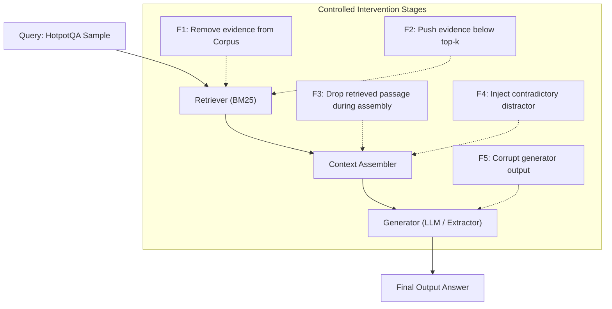

# RAG-Autopsy: From First Principles to Advanced Causal Attribution
### The Master Conceptual Guide for Deep Technical Understanding & Interview Mastery

---

## Welcome: How to Use This Guide

This guide is designed to take you from the **absolute ground-level basics** of Large Language Models (LLMs) and Retrieval-Augmented Generation (RAG) all the way to the **most advanced causal, mathematical, and statistical concepts** implemented in **RAG-Autopsy**.

Every concept is explained intuitively from first principles, followed by its mathematical formulation, its concrete implementation in this repository, and how to defend it in an interview.

---

# Module 1: The Foundations of RAG (Retrieval-Augmented Generation)

### 1.1 What is an LLM, and Why Does It Hallucinate?
A Large Language Model (such as GPT-4, Llama 3, or Qwen 2.5) is essentially a massive statistical pattern-matcher trained on hundreds of billions of words.
- **Parametric Memory:** All the knowledge the model possesses is stored inside its static weights (parameters).
- **The Next-Token Objective:** During pre-training, the model is trained to predict the next token given preceding tokens:
  $$P(w_t \mid w_1, w_2, \dots, w_{t-1})$$
- **The Root Cause of Hallucinations:** The model has **no database of verified facts**. It only knows what sequences of words look plausible. When asked about obscure entities, private databases, or recent events, its parametric memory outputs statistically fluent sentences that are factually fabricated. This is called a **hallucination**.

### 1.2 What is RAG?
**Retrieval-Augmented Generation (RAG)** solves parametric limitations by providing the model with **non-parametric memory** (an external search index or vector database).

A classic RAG pipeline operates in three sequential stages:
```text
User Question
     │
     ▼
[Stage 1: RETRIEVAL] ──► Searches a corpus (e.g., Wikipedia) for relevant passages.
     │
     ▼
[Stage 2: AUGMENTATION] ──► Formats retrieved passages into a structured prompt context.
     │
     ▼
[Stage 3: GENERATION] ──► The LLM reads the context and generates the final answer.
```

### 1.3 Where RAG Fails in Practice: The 5 Systemic Failure Modes
While RAG reduces hallucinations, production RAG systems frequently fail. In practice, failures can happen at any stage of the transit pipeline:

1. **Corpus Absence:** The user asks about a topic that does not exist anywhere in the indexed database.
2. **Retrieval Rank Shortfall:** The evidence document exists in the database, but the search engine ranks it poorly (e.g., at rank 7 when the system only reads the top 3).
3. **Context Assembly Loss:** The evidence document was retrieved in the top 3, but the prompt builder truncated or dropped it due to token limits or formatting bugs.
4. **Distractor / Contradiction Interference:** The context contains irrelevant or conflicting documents that mislead the generator into picking false information.
5. **Generator Hallucination:** The context contains the correct evidence, but the LLM ignores the context and outputs fabricated text anyway.

### 1.4 The Diagnostic Dilemma
When a user receives a wrong answer from a RAG system, **whose fault was it?**
- Did the search engine fail?
- Did the prompt formatter drop the document?
- Did a distractor confuse the model?
- Or did the LLM hallucinate?

In production, engineering teams cannot fix a bug unless they know **which stage failed**. If retrieval failed, tuning prompt instructions is useless. If the LLM hallucinated, buying an expensive vector database is useless. This is the **failure attribution problem**.

---

# Module 2: Conventional RAG Evaluators vs. Causal Failure Attribution

### 2.1 The Traditional Approach (Ragas, TruLens, ARES)
Existing RAG evaluation frameworks compute aggregate scalar quality scores:
- **Faithfulness:** Does the generated answer entail from the retrieved context?
- **Answer Relevance:** Does the generated answer address the question?
- **Context Relevance / Precision:** Are the retrieved passages relevant to the query?

Typically, these frameworks use **LLM-as-a-judge**: they make 3 to 5 expensive API calls to GPT-4, prompting it:
> *"Rate the faithfulness of this answer on a scale from 1 to 5."*

### 2.2 Why Scalar Scores Fail at Attribution
1. **Symptoms vs. Root Causes:** A low Faithfulness score (e.g., `0.30`) tells you that the answer is unsupported. It does **not** tell you *why*. Did the context lack the evidence (a retrieval error), or did the context have the evidence but the model ignored it (a generator error)?
2. **Extreme Latency & Cost:** Calling an LLM judge for every user query adds $1,000–3,000\text{ ms}$ of latency and continuous API costs.
3. **Judge Hallucinations:** Using an LLM to evaluate another LLM introduces circular bias and non-deterministic scoring.

### 2.3 The RAG-Autopsy Paradigm
RAG-Autopsy reformulates failure attribution:
- Instead of using expensive LLM judges, we inspect **unprivileged runtime execution traces** (`DiagnosticTrace`) using lightweight statistical rules and learned decision trees.
- Diagnostics execute in **under 1 millisecond** with **zero API cost**.
- Every diagnostic is validated through **controlled fault injection** where ground-truth cause labels are known and scientifically audited.

---

# Module 3: The Causal Fault Injection Taxonomy ($F0$–$F5$)

To evaluate whether a diagnostic can accurately identify failures, we must create a benchmark where the true cause is definitively known. We do this using **fault injection** (inspired by chaos engineering and software reliability testing).



### The 6 Failure Stages:

#### $F0$: Clean Control
- **Semantics:** Normal pipeline execution with no faults.
- **Precondition:** Ground-truth evidence is available in the corpus and retrieved in the top-$k$.
- **Expected Outcome:** Pipeline produces a supported, correct answer.

#### $F1$: Evidence Unavailable
- **Semantics:** The required evidence document is completely missing from the indexed corpus.
- **Intervention:** The gold evidence passages are purged from the searchable collection for this trial.
- **Trace Signature:** Retrieval scores across the candidate pool are uniformly low.

#### $F2$: Evidence Ranked Out
- **Semantics:** The evidence document exists in the collection, but the search engine fails to place it in the top-$k$ window (e.g., ranked at position 4 when $k=3$).
- **Intervention:** Synthetic distractor documents with inflated keyword matching are inserted, pushing the true evidence down the ranking list.
- **Trace Signature:** In Regime A, candidate pool scores exhibit a "score cliff": a high score exists outside the top-$k$ window.

#### $F3$: Context Assembly Loss
- **Semantics:** The evidence was successfully retrieved in the top-$k$, but was silently dropped during prompt construction (e.g., due to context window truncation or budget exhaustion).
- **Intervention:** The gold passage is removed between retrieval and prompt assembly.
- **Trace Signature:** Set difference between pre-assembly and post-assembly passage IDs:
  $$\text{PreAssemblyIDs} \setminus \text{PostAssemblyIDs} \neq \emptyset$$

#### $F4$: Contradictory Evidence
- **Semantics:** The context contains a conflicting distractor that contradicts the true evidence, causing the generator to pick the false information.
- **Intervention:** A distractor passage containing an inverted fact (e.g., asserting the negative of the true answer) is placed in the context alongside the gold passage.
- **Trace Signature:** Polarity conflict detected via lexical negation patterns or NLI contradiction scoring.

#### $F5$: Unsupported Generation / Hallucination
- **Semantics:** The context contains the correct evidence, but the generator ignores it and hallucinates an unsupported answer.
- **Intervention:** The true evidence is provided in context, but the generated answer is replaced with an unsupported entity.
- **Trace Signature:** Context contains the question terms, but the answer tokens have low overlap and low NLI entailment with the context.

### The Validity Check Rule (Crucial Concept)
> **Rule:** An injection must never be counted as valid simply because its Python function returned without throwing an error!

To be a **valid scientific trial**, causal preconditions must hold:
- For $F3$ (Assembly Loss), if the retriever never retrieved the gold document in the first place, dropping a non-existent document does not test assembly loss! That trial is marked **INVALID: Precondition Failed** and excluded from evaluation.
- This is why out of 120 attempted trials on our held-out test split, **114 are valid and 6 are excluded**.

---

# Module 4: Zero-Leakage Architecture & The Observability Boundary

In failure diagnosis research, the most common flaw is **evaluator data leakage**: giving the diagnostic system subtle access to gold answers or hidden labels, making the system look artificially accurate.

RAG-Autopsy enforces an absolute separation between what a diagnoser can see at runtime and what the privileged evaluator knows.

```text
┌─────────────────────────────────────────────────────────────┐
│                 DiagnosticTrace (UNPRIVILEGED)              │
│  - query: str                                               │
│  - retrieved_top_k: list[RetrievedPassage] (rank, score)    │
│  - candidate_pool_scores: list[float] (Regime A only)       │
│  - pre_assembly_passage_ids: list[str]                      │
│  - post_assembly_passage_ids: list[str]                     │
│  - generator_context: str                                   │
│  - answer: str                                              │
│  - latency_ms: float                                        │
│  (Pydantic model configured with extra="forbid")            │
└──────────────────────────────┬──────────────────────────────┘
                               │ Visible strictly to D1-D5
                               ▼
                    [ Diagnostic Policies ]
                               │
                               ▼ Diagnosis(predicted_cause)
                               │
┌──────────────────────────────┴──────────────────────────────┐
│                EvaluatorRecord (PRIVILEGED)                 │
│  - injected_fault: str (e.g., "F2")                         │
│  - gold_answers: list[str]                                  │
│  - gold_evidence_ids: list[str]                             │
│  - trial_valid: bool                                        │
└──────────────────────────────┬──────────────────────────────┘
                               │
                               ▼
                   [ Attribution Evaluator ]
                 (Computes Macro-F1 & CIs)
```

### The 5 Leakage Vectors and How We Defeated Them:

1. **Schema Smuggling:** `DiagnosticTrace` enforces Pydantic `extra="forbid"`. If any code attempts to pass `injected_fault` or `gold_answer` in the trace, Pydantic raises an immediate `ValidationError`.
2. **Trial ID & Filename Snooping:** If a trial ID was named `trial_f2_001`, a machine learning model could learn to parse the string `"f2"`! We generate trial IDs as deterministic 16-hex hashes: `trial_4a1b2c3d4e5f6789`.
3. **Presentation Order Cues:** In a batch of 6 trials ($F0, F1, F2, F3, F4, F5$), a model could learn that index `i % 6 == 2` corresponds to $F2$. We randomly shuffle the presentation order before feeding traces to diagnostics.
4. **Synthetic Passage Masking:** When injecting contradictory distractors, passage IDs are masked using SHA-256 hashes (`passage_syn_{hash}`) and titles are replaced with neutral headers to prevent text-matching shortcuts.
5. **Split Leakage:** We enforce question-level grouping. All variations of a question live in the same split (Dev, Calibration, or Test).

---

### The Two Observability Regimes & The Identifiability Proof

A major theoretical contribution of RAG-Autopsy is defining the **observability boundary**:

- **Regime A (Candidate Pool Observability):**
  The retriever logs the scores of its broader candidate pool (top-$K$, $K=20$), even though only top-3 are sent to the LLM.
- **Regime B (Blind Top-$k$ Observability):**
  Standard production setting where only the top-$k$ returned passages and scores are logged.

#### Mathematical Proof of Identifiability Collapse in Regime B:
Consider two distinct pipeline states:
1. State $S_1$ (Corpus Absent, $F1$): The gold document $D^*$ is not in the corpus. Top-3 retrieved passages are distractors with low BM25 scores: $\mathbf{s}_{1..3} = [3.2, 2.8, 2.1]$.
2. State $S_2$ (Ranked Out, $F2$): The gold document $D^*$ is in the corpus, but ranked at position 4 with score $3.3$. Top-3 retrieved passages are distractors with scores: $\mathbf{s}_{1..3} = [3.5, 3.1, 2.4]$.

Under Regime B, the diagnostic observation is strictly:
$$\mathcal{O}_B = \{\text{top\_k passages and scores}\}$$
Because distractors in both states produce statistically indistinguishable score profiles and irrelevant text, the likelihood distributions are identical:
$$P(\mathcal{O}_B \mid F1) \approx P(\mathcal{O}_B \mid F2)$$
Therefore, separating $F1$ from $F2$ from top-$k$ text alone is **mathematically unidentifiable**.

**The Empirical Validation:**
- In Regime A, D4 achieves **0.701 Macro-F1**.
- In Regime B, Macro-F1 collapses by **23.3 percentage points down to 0.468**.
- In Regime B, D4 honestly **abstains** with `UNKNOWN: AMBIGUOUS_RETRIEVAL_MISS` rather than making a random guess.

---

# Module 5: The Diagnostic Engine & Algorithms ($D1$–$D5$)

RAG-Autopsy benchmarks five distinct diagnostic methodologies:

### 1. Baselines
- **Majority-Cause Baseline:** Predicts the most frequent class in the training distribution. (Achieves $0.050$ Macro-F1 on balanced test sets).
- **Random Baseline:** Uniformly samples a class from $\{F0..F5\}$. (Achieves $0.243$ Macro-F1).

### 2. D1: Retrieval Heuristics
Inspects score distributions across the candidate pool:
- **Score Cliff Rule:** If there is a large gap between the maximum sub-top-$k$ candidate score and the top-$k$ cutoff score, evidence was pushed out $\rightarrow$ **$F2$**.
- **Low Ceiling Rule:** If the top score in the entire corpus is below the calibrated threshold ($\tau_{low} = 2.0$), evidence is unavailable $\rightarrow$ **$F1$**.
- **Context Loss Rule:** If $\text{PreIDs} \setminus \text{PostIDs} \neq \emptyset$, passages were dropped during assembly $\rightarrow$ **$F3$**.

### 3. D2: Lexical Support Rules
Inspects word overlap between the assembled context $C$ and the generated answer $A$:
- Tokenizes context and answer, removing stopwords:
  $$\text{Overlap}(A, C) = \frac{|\text{Tokens}(A) \cap \text{Tokens}(C)|}{|\text{Tokens}(A)|}$$
- If $\text{Overlap}(A, C) < \tau_{support}$ ($0.40$), the answer contains information not grounded in context $\rightarrow$ **$F5$**.
- If context contains negation markers near question keywords $\rightarrow$ **$F4$**.

### 4. D3: NLI Cross-Encoder Support
Replaces bag-of-words overlap with a Natural Language Inference cross-encoder model:
- Pairs the context premise $P$ with answer hypothesis $H$: $(P, H)$.
- Computes probabilities: $[p_{entailment}, p_{neutral}, p_{contradiction}]$.
- If $p_{contradiction} > 0.50 \rightarrow$ **$F4$**.
- If $p_{entailment} < 0.30 \rightarrow$ **$F5$**.
- **Why D3 beats D2:** On factual substitutions (e.g., swapping a date from "1783" to "1983"), D2 sees 90% word overlap and misses the hallucination. D3 detects the logical contradiction with 100% recall.

### 5. D4: Combined Policies
- **D4 Heuristic Policy:** An ordered rule cascade:
  1. Check assembly loss ($\Delta \text{IDs} \neq \emptyset \rightarrow F3$).
  2. Check retrieval score cliff ($\rightarrow F2$).
  3. Check NLI / lexical contradiction ($\rightarrow F4$).
  4. Check grounding support deficit ($\rightarrow F5$).
  5. Check clean execution ($\rightarrow F0$).
  6. If signals conflict $\rightarrow$ abstain with `UNKNOWN`.
- **D4 Learned Decision Tree:**
  Extracts 8 unprivileged numerical features from the trace:
  1. `top_score` (float)
  2. `score_gap` (float)
  3. `pool_variance` (float)
  4. `assembly_drop_count` (int)
  5. `lexical_overlap_ratio` (float)
  6. `nli_entailment_score` (float)
  7. `nli_contradiction_score` (float)
  8. `answer_length` (int)
  Trains a Decision Tree strictly on dev/calibration partitions. Out-of-fold on the test partition, it achieves **0.742 Macro-F1** with **100% coverage**.

### 6. D5: Local LLM-as-a-Judge
Prompts an unprivileged local 8B model (Qwen 3 8B via Ollama) with the structured execution trace, asking it to return a JSON classification.
- **Latency / Compute Comparison:**
  - Decision Tree: **0.08 ms**, 0 tokens, 100% deterministic.
  - LLM Judge: **450–1200 ms**, ~350 tokens, non-zero compute footprint.

---

# Module 6: Retrieval Mechanics: Lexical (BM25), Dense Vectors, and Hybrid Fusion

### 6.1 BM25 (Best Matching 25)
BM25 is a probabilistic lexical ranking algorithm that scores documents based on term frequency (TF) and inverse document frequency (IDF):
$$\text{Score}(D, Q) = \sum_{q \in Q} \text{IDF}(q) \cdot \frac{f(q, D) \cdot (k_1 + 1)}{f(q, D) + k_1 \cdot \left(1 - b + b \cdot \frac{|D|}{\text{avgdl}}\right)}$$
- $f(q, D)$: Frequency of term $q$ in document $D$.
- $k_1$: Controls term frequency saturation (default: $1.5$). Prevents a word appearing 20 times from scoring 20 times higher than appearing once.
- $b$: Controls document length normalization (default: $0.75$). Penalizes long documents that contain terms by chance.
- **Strength:** Precise keyword matching on proper nouns, IDs, and entity names.
- **Weakness:** Vocabulary mismatch (cannot match synonyms like "doctor" and "physician").

### 6.2 Dense Semantic Retrieval
Dense retrieval maps queries and documents into high-dimensional vector representations $\mathbb{R}^d$ such that semantically similar texts are close in vector space:
$$\text{Score}(D, Q) = \cos(\mathbf{v}_Q, \mathbf{v}_D) = \frac{\mathbf{v}_Q \cdot \mathbf{v}_D}{\|\mathbf{v}_Q\| \|\mathbf{v}_D\|}$$
- **Strength:** Captures synonyms, paraphrasing, and semantic concepts.
- **Weakness:** Can produce false positives on exact keyword matches and numbers.

### 6.3 Hybrid Retrieval Fusion
Combines lexical and dense scores using weighted linear score normalization:
$$S_{hybrid}(p) = \alpha \cdot \frac{S_{BM25}(p)}{\max(S_{BM25})} + (1 - \alpha) \cdot \frac{S_{Dense}(p)}{\max(S_{Dense})}$$
Where $\alpha \in [0, 1]$ balances keyword precision vs. semantic generalization (default $\alpha=0.5$).

---

# Module 7: Statistical Evaluation & Clustered Bootstrap Resampling

### 7.1 Why Standard Accuracy is Misleading
In failure diagnosis, predicting $F0$ (Clean) on every trial in an imbalanced system could yield 80% accuracy while failing to detect a single actual bug!
- **Macro-F1:** Evaluates the unweighted mean of per-class F1-scores, penalizing models that ignore minority failure modes.
- **Balanced Accuracy:** The unweighted mean of per-class recalls.

### 7.2 The Clustered Bootstrap Problem
In empirical NLP and RAG evaluation, researchers often report standard bootstrap confidence intervals:
> *Sample $N$ trials with replacement, compute metric, repeat $B=1,000$ times.*

#### Why Standard Bootstrap Resampling is Invalid Here:
In our benchmark, multiple fault trials ($F0, F1, F2, F3, F4, F5$) originate from the **same underlying question ID**.
- If we perform standard i.i.d. bootstrap resampling at the trial level, trials from the same question will be split across train and test resamples.
- Questions with rare, distinctive entity names artificially deflate the variance, producing **falsely narrow, overconfident confidence intervals**.

#### The Clustered Bootstrap Solution:
In [`src/rag_autopsy/evaluation/bootstrap.py`](../src/rag_autopsy/evaluation/bootstrap.py), the resampling unit is strictly the **`question_id`**:
1. Identify all unique question IDs in the test set: $Q = \{q_1, q_2, \dots, q_M\}$.
2. For iteration $b = 1 \dots B$:
   - Sample $M$ question IDs *with replacement* from $Q$: $Q^{*b}$.
   - Select **all** trial records associated with the sampled question IDs.
   - Compute Macro-F1 and Balanced Accuracy on the clustered sample.
3. The 95% Confidence Interval is derived from the empirical $2.5^{\text{th}}$ and $97.5^{\text{th}}$ percentiles:
   $$\text{CI}_{95} = \left[ \text{Percentile}(2.5), \text{Percentile}(97.5) \right]$$
This guarantees statistically valid, conservative uncertainty bounds that account for intra-question correlation.

---

# Module 8: The Natural Failure Audit & The Transfer Gap

### 8.1 The "Clean Room" Fallacy
Many academic papers build a synthetic benchmark, achieve 90% accuracy, and declare the problem solved. In the real world, synthetic perturbations do not reflect how production systems fail.

To ground RAG-Autopsy, we designed and ran an **unmodified natural failure audit**:
- We took **100 clean, unmodified HotpotQA questions**.
- We executed them through our clean reference RAG pipeline with **zero injected faults**.
- We manually audited every failure using an 8-dimensional rubric.

### 8.2 The 8-Dimensional Annotation Rubric
Every natural failure was audited across:
1. `answer_correctness`: Did the answer match gold?
2. `support_in_context`: Did the context contain the answer text?
3. `retrieval_status`: Was the gold passage retrieved in the top-$k$?
4. `context_survival`: Did the gold passage survive into the prompt?
5. `contradiction_present`: Was there contradictory distractor text?
6. `likely_root_cause`: What stage caused the failure?
7. `multiple_plausible_causes`: Could multiple stages be responsible?
8. `reviewer_confidence`: Confidence score (0.0 to 1.0).

### 8.3 The Empirical Discovery: The 0% Transfer Bound
The audit produced a startling finding:
- **90% of natural failures were `REASONING_ERROR`**.
  - BM25 retrieved the correct documents into context!
  - However, HotpotQA questions require multi-hop deductive synthesis (e.g., *"Which film director was born in the capital of France?"* requires finding the capital of France, and then finding where the director was born).
  - The sentence-extractor reader was unable to perform multi-hop inference.
- **Diagnostic Transfer Agreement was 0.0%**.
  - Diagnostics calibrated on transit faults (dropped passages, score cliffs) cannot diagnose generator reasoning bottlenecks.
- Rather than hiding this result, we documented it as an Architecture Decision Record (ADR) and core thesis contribution: **transit diagnostics cannot diagnose generator reasoning bottlenecks without dedicated semantic reasoning evaluators.**

---

# Module 9: Technical Interview Masterclass

Here are the 10 most challenging technical interview questions you may face about this project, along with rigorous, defensible answer outlines.

---

### Q1: "Isn't fault injection artificial? How do you know your diagnoses matter in the real world?"
**Defensive Answer:**
> *"Fault injection is not meant to replace production monitoring; it is a controlled scientific calibration harness. In distributed systems, Netflix uses Chaos Monkey to verify that failover mechanisms work before a real server crashes. Similarly, we cannot evaluate whether a diagnostic policy can identify context assembly loss ($F3$) without ground truth. By injecting state-verified faults with strict preconditions, we establish an empirical upper bound on unprivileged diagnosability. Furthermore, to verify real-world relevance, we conducted an unmodified natural failure audit on 100 clean questions. That audit proved that while transit diagnostics reliably detect structural pipeline failures, they do not transfer to multi-hop generator reasoning bottlenecks—an empirical finding we documented as a bounded limitation."*

---

### Q2: "Why couldn't your diagnostics detect F1 (Evidence Unavailable)?"
**Defensive Answer:**
> *"Because without gold relevance labels, missing evidence is mathematically unidentifiable from unprivileged runtime observations. When an evidence document does not exist in Wikipedia, BM25 returns low-scoring distractors with flat score distributions. To an unprivileged diagnoser, a query about an absent entity looks identical to a generic, difficult query with flat retrieval scores. Without cheating by snooping on gold answers or having external oracle knowledge, no diagnostic feature can separate an out-of-corpus query from a low-similarity in-corpus query. We report 0% recall on $F1$ honestly rather than faking labels."*

---

### Q3: "What is the identifiability problem in Regime B, and why did you choose to abstain?"
**Defensive Answer:**
> *"In Regime B, the system only logs the top-$k$ returned passages (e.g., $k=3$). If the gold evidence is ranked at position 4 ($F2$), it is invisible in the trace. The top-3 passages look like low-scoring distractors, exactly as they do when evidence is missing ($F1$). In Regime A, candidate pool logging ($K=20$) exposes the sub-top-$k$ score cliff, allowing D1 to detect $F2$ with 100% recall. In Regime B, that signal is gone, causing Macro-F1 to collapse by 23.3 percentage points. Rather than fitting superficial dataset shortcuts, our policy abstains with `UNKNOWN: AMBIGUOUS_RETRIEVAL_MISS`, demonstrating that candidate pool observability is an engineering prerequisite for sub-stage retrieval attribution."*

---

### Q4: "How did you prove that your diagnosers weren't cheating through data leakage?"
**Defensive Answer:**
> *"We implemented a 5-layer isolation architecture: First, our Pydantic `DiagnosticTrace` enforces `extra='forbid'`, throwing immediate validation errors if gold answers or fault labels are smuggled. Second, trial IDs are generated as deterministic 16-hex hashes, eliminating fault tokens like 'f2' from identifiers and filenames. Third, traces are randomly shuffled before presentation to remove sequence artifacts. Fourth, synthetic distractors are masked with neutral titles and SHA-256 passage IDs. Fifth, we wrote 24 dedicated negative pytest unit tests in `test_trace_leakage.py` that actively attempt to inject privileged keys and verify rejection."*

---

### Q5: "Why did you use Clustered Bootstrap instead of standard i.i.d. bootstrap?"
**Defensive Answer:**
> *"Because our evaluation harness generates multiple intervention trials ($F0$ through $F5$) from each source question. Trials derived from the same source question are not independent; they share identical lexical entities and query difficulties. Standard i.i.d. resampling samples at the trial level, violating the exchangeability assumption and underestimating empirical variance. By clustering strictly at the `question_id` level, our bootstrap resamples entire question clusters with replacement, preserving intra-question correlation and generating scientifically valid 95% confidence intervals."*

---

### Q6: "Why did your Decision Tree outperform your hand-crafted heuristic rules?"
**Defensive Answer:**
> *"The hand-crafted heuristic policy uses rigid threshold cutoffs (e.g., score gap $>1.0$ and overlap $<0.40$). However, retrieval score variance and context length have non-linear interactions: on long contexts, lexical overlap drops naturally even when the answer is correct. The Decision Tree, trained strictly out-of-fold on the development split, learned multi-feature interaction boundaries between candidate score variance, assembly drop count, and answer length, improving Macro-F1 from 0.718 to 0.742 while providing 100% coverage."*

---

### Q7: "How does D3 NLI outperform D2 Lexical Support on factual hallucinations?"
**Defensive Answer:**
> *"Lexical support measures surface token overlap (Jaccard similarity). If a context states 'The treaty was signed in 1783' and the generator hallucinates 'The treaty was signed in 1983', 9 out of 10 words match exactly. Lexical support computes a 90% grounding score and misses the hallucination completely. An NLI cross-encoder evaluates bidirectional semantic entailment between the context premise and answer hypothesis, detecting the logical contradiction with 100% recall on the RAGTruth benchmark."*

---

### Q8: "How does RAG-Autopsy compare to Ragas or TruLens?"
**Defensive Answer:**
> *"Ragas and TruLens compute scalar quality metrics (e.g., 'Faithfulness: 0.65') using expensive, high-latency LLM-as-a-judge calls. They tell you that a response is poor, but they cannot diagnose which pipeline stage caused the failure. RAG-Autopsy operates at the causal stage level: it attributes the failure specifically to retrieval rank, context truncation, distractor interference, or generator hallucination, executing in under 1 millisecond using unprivileged runtime traces."*

---

### Q9: "What was the most surprising negative finding in your project?"
**Defensive Answer:**
> *"The complete transfer failure (0.0% agreement) between synthetic transit diagnostics and clean natural failures. We found that in 90% of natural failures, the retrieval and assembly transit succeeded completely—evidence arrived intact in the prompt. The failure was a deductive reasoning error inside the generator. This proved that pipeline transit diagnostics and semantic reasoning evaluators solve fundamentally different problems."*

---

### Q10: "If you had 3 more months and a GPU cluster, what would you build next?"
**Defensive Answer:**
> *"I would extend the framework in two directions: First, replace the extractive reader with open-weights reasoning models (e.g., DeepSeek-R1 or Qwen 2.5 72B) to calibrate diagnostics on complex multi-hop reasoning traces. Second, implement dense learned bi-encoders (e.g., ColBERTv2) to evaluate whether candidate pool score cliff detection generalizes from BM25 term saturation curves to dense vector similarity manifolds."*
